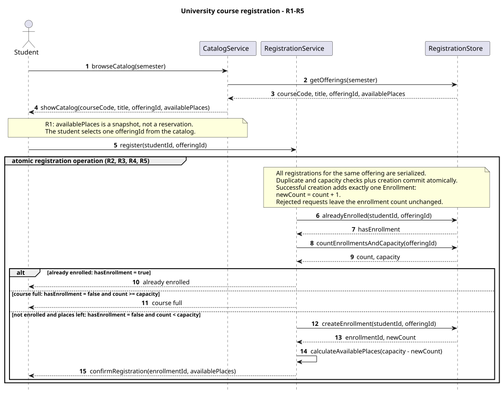
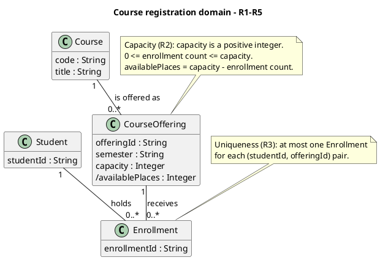
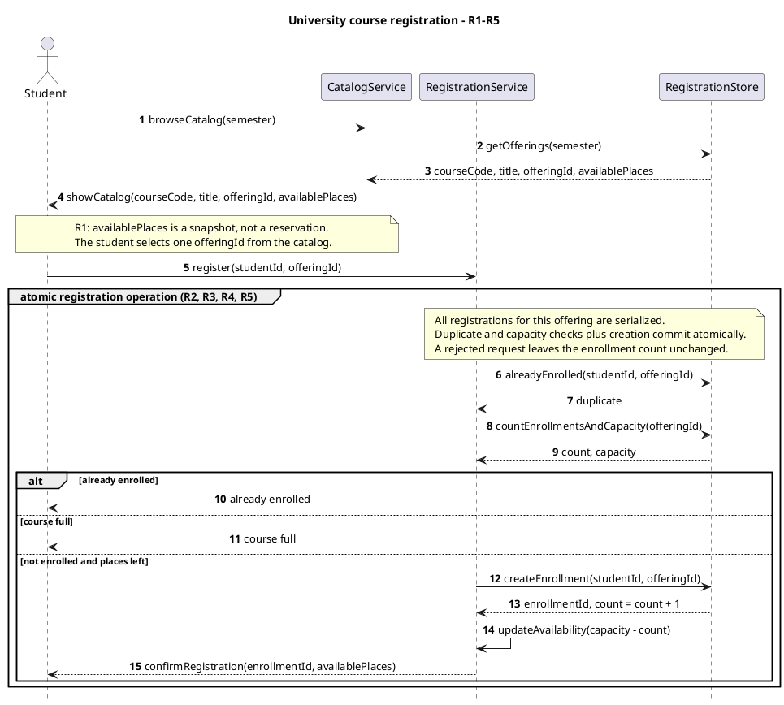
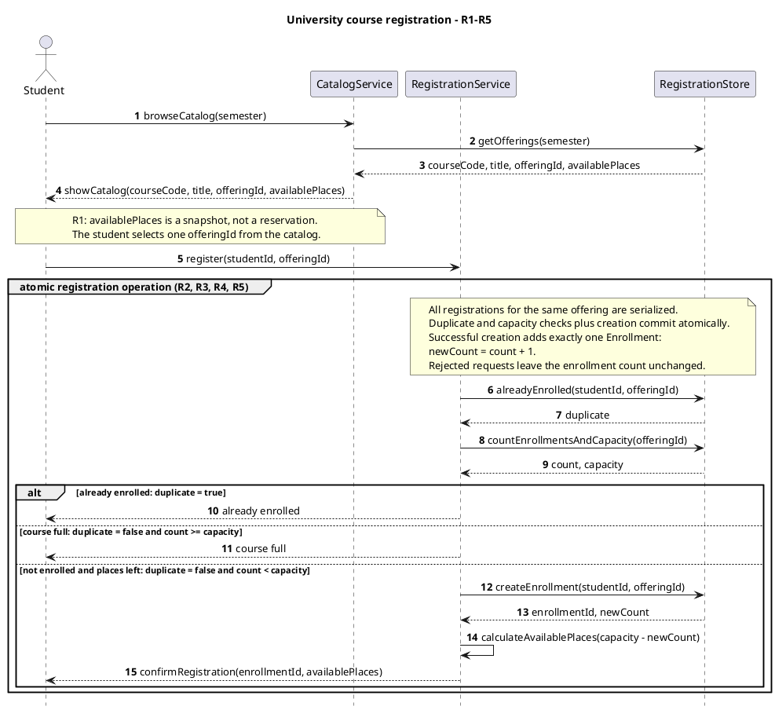
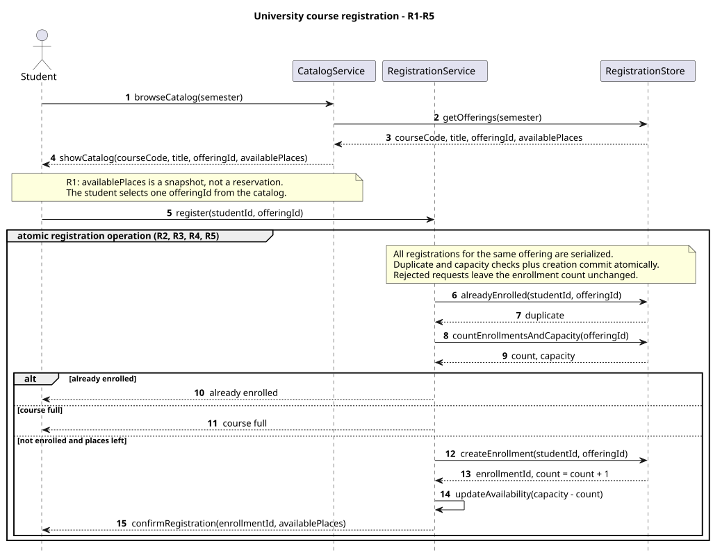
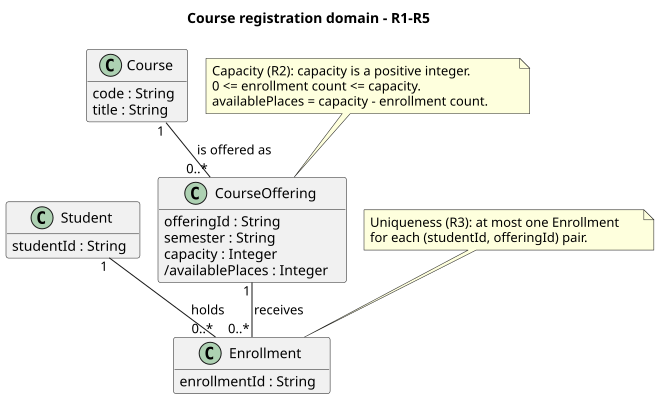

# SIS #02 — AI-Assisted UML Modeling: University Course Registration

> TECHNICAL DRAFT — prepared by the assistant at the student's direct request, initially outside the prescribed A–D exchanges. The genuine A–D stages have since been performed, with workflow deviations disclosed in section 11. This is not a completed workflow record. The student pushed commit 5fc8b60 before the genuine Prompt A, but that commit already included the earlier AI technical draft. Independent Prompt C and student rewriting/verification of the prose remain unresolved; see AI_USAGE.md. Initial push 5fc8b60 is evidenced by the student’s terminal output. The reflection is an AI-assisted draft based on student answers, not independently authored student prose. Do not submit unchanged.

## 1. Scope and assumptions

**Scope:** Model semester catalog browsing, selection of a CourseOffering and registration with atomic duplicate and capacity checks. Confirm success or explain rejection without changing state. Payments, prerequisites, timetable clashes, waiting lists and cancellation are out of scope.

**Assumptions:**

1. The student is already signed in.
2. The selected offering exists and capacity is a positive whole number.
3. Proposed design assumption: a Course may currently have zero CourseOfferings; each offering belongs to exactly one Course.
4. Proposed outcome priority: an existing enrollment is reported before fullness when both conditions hold.

## 2. User stories and acceptance criteria

Approved by the student in this chat on 2026-10-18 after reviewing the genuine Prompt A response. Duplicate rejection has priority when the offering is also full.

### US-01 — Browse offerings

**US-01:** As a student, I want to browse course offerings for one semester, so that I can choose a specific offering.

- **AC-01** (R1): Given course offerings exist for the selected semester, When the student opens its catalog, Then each offering displays the course code, title, offering identifier and available places.
- **AC-02** (R1, R2): Given the catalog shows an available place, When the student selects that offering, Then the selection reserves no place, and current availability must be checked again during registration.

### US-02 — Register for an offering

**US-02:** As a student, I want to register for a selected offering, so that I receive confirmation of my enrollment.

- **AC-03** (R2, R3, R4): Given an offering has capacity 2, enrollment count 0 and no enrollment for the requesting student, When the student requests registration, Then duplicate and current capacity checks and creation occur atomically, exactly one Enrollment links the student to the offering, the count becomes 1, available places become 1 and confirmation is returned.
- **AC-04** (R2, R3, R4): Given an offering has capacity 2, enrollment count 1 and no enrollment for either of two requesting students, When both students request the last place, Then atomic checks and creation allow exactly one request to succeed, create exactly one Enrollment, change the count to 2 and available places to 0, and confirm only the successful request.

### US-03 — Receive a clear rejection

**US-03:** As a student, I want a clear reason when registration is rejected, so that I understand why no enrollment was created.

- **AC-05** (R2, R5): Given the catalog previously showed a place but the offering now has enrollment count 2 and capacity 2, and the requesting student is not enrolled, When registration is requested, Then the system rechecks current capacity, returns “course full,” creates no Enrollment and leaves the count at 2.
- **AC-06** (R3, R5): Given the student already has an Enrollment in an offering with capacity 2 and enrollment count 1, When the student requests registration again, Then the system returns “already enrolled,” creates no additional Enrollment and leaves the count at 1.

## 3. Sequence diagram

**Participants:** Student is the signed-in requester. CatalogService presents semester offerings. RegistrationService coordinates registration. RegistrationStore reads and creates enrollment records.

**Atomic operation:** Final naming adjustment after D: the Boolean is called hasEnrollment in its return message and all guards; this preserves the accepted conditions. The atomic registration operation serializes all requests for the same offering. It includes alreadyEnrolled, countEnrollmentsAndCapacity, the guarded decision and createEnrollment. The resulting availability is derived before confirmRegistration. Catalog browsing reserves nothing. A database implementation would have to enforce both uniqueness and capacity under concurrency.

**Where the Enrollment is created:** RegistrationService sends createEnrollment(studentId, offeringId) to RegistrationStore only in the success branch. This creates one record of domain class Enrollment, linking the identified Student and CourseOffering.

**Technical lifelines:** CatalogService, RegistrationService and RegistrationStore represent application and storage responsibilities, rather than domain entities. Their omission from the domain class diagram is deliberate. Student represents the actor corresponding to the Student domain concept.

## 4. Class diagram

| Association | Read left to right | Read right to left |
| --- | --- | --- |
| Student — Enrollment | One Student holds zero or many Enrollments. | Each Enrollment belongs to exactly one Student. |
| CourseOffering — Enrollment | One CourseOffering receives zero or many Enrollments. | Each Enrollment targets exactly one CourseOffering. |
| Course — CourseOffering | One Course has zero or many CourseOfferings. | Each CourseOffering describes exactly one Course. |

**How an Enrollment links a student to an offering:** Two mandatory associations give each Enrollment exactly one Student and exactly one CourseOffering. Registration uses studentId and offeringId to identify the endpoints.

**Capacity constraint:** For every offering, capacity is a positive integer and 0 <= enrollment count <= capacity. availablePlaces is derived as capacity minus enrollment count. A fixed 0..* multiplicity cannot express an upper bound taken from another attribute.

**Uniqueness constraint:** Each (studentId, offeringId) pair occurs in at most one Enrollment. Multiplicities constrain the number of links per endpoint; they do not prohibit separate Enrollment objects from connecting the same pair.

## 5. Traceability

| Rule and criterion | Model evidence | Validation case |
| --- | --- | --- |
| R1 + AC-01, AC-02 | browseCatalog, getOfferings and showCatalog include semester, courseCode, title, offeringId and availablePlaces. | Assistant catalog inspection: all four displayed fields and semester argument are present; selection note reserves nothing. |
| R2 + AC-02, AC-03, AC-04, AC-05 | countEnrollmentsAndCapacity follows register; atomic note serializes competing registrations; capacity note constrains count. | T1, T2, T3; additional last-place interleaving inspection. |
| R3 + AC-03, AC-04, AC-06 | alreadyEnrolled check precedes creation; already enrolled branch; uniqueness note. | T4. |
| R4 + AC-03, AC-04 | createEnrollment followed by calculateAvailablePlaces and confirmRegistration in success branch only. | T1, T2. |
| R5 + AC-05, AC-06 | course full and already enrolled branches return reasons without any write or confirmation. | T3, T4. |

## 6. Walkthroughs

The following paths were traced by the assistant against the supplied source. They are not claimed as student-authored walkthroughs. The student must independently trace and rewrite or approve them with disclosure.

| Case | Observed path and state change | Judgment and evidence |
| --- | --- | --- |
| T1. Available | browseCatalog → getOfferings → showCatalog; select offering; register; alreadyEnrolled returns hasEnrollment=false; countEnrollmentsAndCapacity returns 0 and 2; success guard; createEnrollment; count 0 to 1; calculateAvailablePlaces derives 1; confirmRegistration. | Pass — success guard not enrolled and places left; createEnrollment precedes confirmRegistration; atomic note covers the checks. |
| T2. Last place | browseCatalog → getOfferings → showCatalog; select offering; register; alreadyEnrolled returns hasEnrollment=false; countEnrollmentsAndCapacity returns 1 and 2; success guard; createEnrollment; count 1 to 2; calculateAvailablePlaces derives 0; confirmRegistration. | Pass — atomic registration note and createEnrollment; a serialized second new student sees count 2 and takes course full. |
| T3. Full | browseCatalog → getOfferings → showCatalog originally displays one place; another registration fills it; register; alreadyEnrolled returns hasEnrollment=false; countEnrollmentsAndCapacity returns 2 and 2; course full branch returns course full; no creation; count remains 2. | Pass — course full guard uses the current count after register; rejection branch has no state-changing message. |
| T4. Duplicate | browseCatalog → getOfferings → showCatalog; select offering; register; alreadyEnrolled returns hasEnrollment=true; countEnrollmentsAndCapacity returns 1 and 2; already enrolled branch returns already enrolled; no creation; count remains 1. | Pass — already enrolled guard precedes the other outcomes and returns only the rejection reason. |

Additional assistant check: if a duplicate request also sees a full offering, the duplicate guard wins. This priority is a proposed design decision, not a university policy.

**Last-place concurrency walkthrough — requested by the student:** Start with capacity 2 and count 1. Fictional students A and B both see availablePlaces 1 in their catalog snapshots. If A enters the atomic registration operation first, alreadyEnrolled returns hasEnrollment=false and countEnrollmentsAndCapacity returns count 1, capacity 2. A takes not enrolled and places left, creates one Enrollment, changes count to 2 and receives confirmation with zero places. Only after A completes can B enter the same offering's serialized atomic operation. B has no duplicate, but now reads count 2, capacity 2; B takes course full, creates nothing and leaves count 2. If B enters first, the roles reverse: B succeeds and A is rejected. Both possible serialized orders preserve count <= capacity and produce exactly one new Enrollment. A stale catalog snapshot does not reserve the place.

**Concurrency verdict:** Pass at the model level, located in the atomic registration note and the current capacity check before createEnrollment. This is a manual trace of the model's specified serialization, not an execution test of a database or proof that an implementation enforces the note. If both requests could read count 1 before either created an Enrollment, the implementation would violate that atomic requirement.

## 7. Review decisions

The student accepted C1–C3 after the same-chat critique and previously accepted the CourseOffering multiplicity and duplicate priority. Reasons below were drafted by the assistant and require student verification. This was not an independent new-chat critique.

| AI suggestion or model element | Decision | Reason | Rule |
| --- | --- | --- | --- |
| C1: overlapping informal guards | Accepted: make all three guards mutually exclusive. | Explicit enrollment and count conditions make duplicate priority clear even when the offering is also full. | R2, R3, R5 |
| C2: updateAvailability naming | Accepted: use calculateAvailablePlaces with the resulting count. | Availability is derived from capacity and enrollment count, so calculation avoids implying a separately stored counter. | R4 |
| C3: assignment inside a return message | Accepted: return newCount and specify creation increases count once. | A return message reports the resulting state while createEnrollment performs the single permitted enrollment state change. | R4 |
| Course to CourseOffering 0..* | Accepted by student: allow unscheduled subjects. | The student said this seemed more correct; the scenario does not require every subject to have a scheduled section. | R1 |
| Final Boolean name | Rename duplicate to hasEnrollment consistently in the return and guards. | The descriptive Boolean distinguishes predicate values from rejection labels and avoids the checker's keyword misclassification of false conditions. | R2, R3, R5 |
| Atomic group and uniqueness note | Retained after inspection. | Serialization protects the last place, while pair uniqueness prevents repeat registration independently of the association multiplicities. | R2, R3 |
| Prose authorship | Keep the AI assistance fully disclosed; student rewriting remains needed. | The reflection expands actual student answers, but the assistant wrote the explanation and walkthroughs rather than the student independently. | R1-R5 |
| Same-chat C and outdated D input | Disclose deviations instead of claiming the prescribed workflow was followed exactly. | The source text and follow-up approval remain recorded accurately even though the new-chat critique requirement was not met. | R1-R5 |

## 8. Modeling explanation

<!-- Assistant-authored draft, requiring student understanding and rewriting to meet the authorship requirement. -->
The model separates a Course from a CourseOffering because a subject and a scheduled section are different concepts. Course contains the code and title, while CourseOffering contains the semester, identifier and capacity. Registration always targets an offering, rather than the general subject. A course may have no scheduled offerings, so its offering multiplicity is zero to many.

Enrollment represents the connection between one Student and one CourseOffering. Each student and offering can be associated with many enrollment records, but every individual enrollment refers to exactly one of each. These associations describe structure. They cannot express the offering's variable capacity or prevent two records with the same student and offering identifiers, so separate constraints state those rules.

The sequence begins with catalog browsing and selection. Its displayed availability is only a snapshot. After the registration request, the system checks duplicates and current capacity inside one atomic operation. A duplicate receives already enrolled; a new student facing a full offering receives course full. Neither rejection changes state. Only the success branch creates an enrollment, derives the new availability and returns confirmation.

CatalogService, RegistrationService and RegistrationStore are technical lifelines, while the class diagram shows domain concepts. This difference keeps storage coordination separate from the domain structure. The sequence diagram explains when checks and changes occur; the class diagram explains what the records mean. An activity diagram could complement them by presenting the student's choices and the three outcomes as a compact workflow. Atomicity remains a modeling requirement, not evidence of a tested implementation.

## 9. Reflection

<!-- AI-expanded English draft based on the student's actual Kazakh answers and this conversation. This is not independently authored student prose; student review and rewriting remain necessary. -->
At the beginning, this task was difficult for me. Later, I understood the difference between Course and CourseOffering. AI helped me most by explaining this difference with examples. For example, Software Engineering is a Course. Software Engineering for group A in the autumn semester of 2026 is a CourseOffering. The first concept describes the subject, while the second identifies a particular scheduled section.

I agreed with the third proposed modeling decision, which allows a Course to exist without a scheduled CourseOffering. This decision seemed more correct to me. I have not yet given a more detailed independent reason for accepting it.

I also wanted to check the last available place when two students request registration. The assistant traced both possible serialized orders: one student receives confirmation and the other receives course full. This showed why the current count must be checked during registration. The remaining limitation of this check is that it follows the model's atomicity assumption; it does not test a working registration system.

## 10. Appendix A — Before AI

**Scope:** The student opens the course catalog, selects a course offering and requests registration. The system checks whether places are available.

**Initial assumptions:**

1. The student is already signed in.
2. The selected course offering exists, and its capacity is a positive whole number.

<!-- These English statements translate the student's Kazakh answers in this conversation. The preceding AI guidance and translation assistance must be disclosed. A commit and push before the required Prompt A have not been verified. -->

## 11. Appendix B — AI exchanges

Actual assistance: ChatGPT Work / model not displayed / 2026-10-18. The student asked the assistant to prepare the work fully. The assistant explained scope and assumptions, translated the student's answers and prepared this technical draft. The genuine Prompt A has been executed and approved; Prompt B has been executed and its original sources preserved. C and D have now been performed in this chat; the required new-chat critique did not occur. Prompt D used an outdated initial input followed by explicit approval before revision. The initial student push is 5fc8b60 and already contains the earlier AI draft; no claim is made that the baseline was written without AI assistance.

### B1 — Requirements (Prompt A)

- **Tool:** ChatGPT Work
- **Model:** not displayed
- **Date:** 2026-10-18
- **Purpose:** draft 3 user stories and 6 acceptance criteria

**Prompt:**

~~~~text
Act as a requirements analyst. Use only this course registration scenario and rules R1–R5: A student browses an electronic course catalog, chooses a course offering and requests
registration. Each offering has a limited number of places.

A Course describes a subject. A CourseOffering is one scheduled section in one semester.
Registration always targets a specific offering.

Assume that the student is signed in, the selected offering exists, and its capacity is a
positive whole number.

Exclude payments, prerequisites, timetable clashes, waiting lists and cancellation. Use
fictional students and courses.

| Rule | |
| --- | --- |
| **R1. Catalog** | Show the course code, title, offering and available places for one semester. |
| **R2. Capacity** | Recheck current availability when registering. Enrollment must never exceed the offering's capacity. |
| **R3. Duplicates** | A student may have at most one enrollment in the same offering. Reject a repeat request. |
| **R4. Success** | Create exactly one Enrollment linking the student and offering, update availability and return a confirmation. |
| **R5. Rejection** | Explain "course full" or "already enrolled". Create no enrollment and leave the enrollment count unchanged. |

These rules define this assignment. **A catalog view does not reserve a place.** Model the final
checks and enrollment creation as one atomic operation so competing requests cannot take the same
last place. A note describing the atomic operation is sufficient; database implementation is
outside this assignment.. My initial assumptions are 1. The student is already signed in. 2. The selected course offering exists, and its capacity is a positive whole number..
Draft 3 user stories and 2 Given / When / Then acceptance criteria for each. Use IDs US-01 to US-03 and AC-01 to AC-06. Map each criterion to rule IDs.
Cover normal and rejection behavior. List uncertainty separately. Do not add excluded features or invent university policies.
~~~~

**Response:**

~~~~text
### US-01 — Browse offerings

**US-01:** As a student, I want to browse course offerings for one semester, so that I can choose a specific offering.

- **AC-01 (R1):** Given course offerings exist for the selected semester, When the student opens its catalog, Then each offering displays the course code, title, offering identifier and available places.
- **AC-02 (R1, R2):** Given the catalog shows an available place, When the student selects that offering, Then the selection reserves no place, and current availability must be checked again during registration.

### US-02 — Register for an offering

**US-02:** As a student, I want to register for a selected offering, so that I receive confirmation of my enrollment.

- **AC-03 (R2, R3, R4):** Given an offering has capacity 2, enrollment count 0 and no enrollment for the requesting student, When the student requests registration, Then duplicate and current capacity checks and creation occur atomically, exactly one Enrollment links the student to the offering, the count becomes 1, available places become 1 and confirmation is returned.
- **AC-04 (R2, R3, R4):** Given an offering has capacity 2, enrollment count 1 and no enrollment for either of two requesting students, When both students request the last place, Then atomic checks and creation allow exactly one request to succeed, create exactly one Enrollment, change the count to 2 and available places to 0, and confirm only the successful request.

### US-03 — Receive a clear rejection

**US-03:** As a student, I want a clear reason when registration is rejected, so that I understand why no enrollment was created.

- **AC-05 (R2, R5):** Given the catalog previously showed a place but the offering now has enrollment count 2 and capacity 2, and the requesting student is not enrolled, When registration is requested, Then the system rechecks current capacity, returns “course full,” creates no Enrollment and leaves the count at 2.
- **AC-06 (R3, R5):** Given the student already has an Enrollment in an offering with capacity 2 and enrollment count 1, When the student requests registration again, Then the system returns “already enrolled,” creates no additional Enrollment and leaves the count at 1.

### Uncertainty

- The rules do not specify which rejection reason takes priority when a student is already enrolled and the offering is also full. Checking duplicates first is a proposed design choice requiring your approval.
- The rules require atomic registration but leave the implementation mechanism unspecified. The model can state this requirement without choosing a database technology.
~~~~

### B2 — UML drafts (Prompt B)

- **Tool:** ChatGPT Work
- **Model:** not displayed
- **Date:** 2026-10-18
- **Purpose:** draft the sequence and class diagrams

**Prompt:**

~~~~text
Using my approved scenario, R1–R5, stories and criteria below, return separate PlantUML code blocks for a sequence diagram and a domain class diagram.
Sequence: include catalog browsing and guarded success, full-course and duplicate outcomes. Model final checks and creation as one atomic operation.
Class: show domain concepts, useful attributes and multiplicities. State the capacity and uniqueness constraints. Explain assumptions and any technical lifelines.

A student browses an electronic course catalog, chooses a course offering and requests
registration. Each offering has a limited number of places.

A Course describes a subject. A CourseOffering is one scheduled section in one semester.
Registration always targets a specific offering.

Assume that the student is signed in, the selected offering exists, and its capacity is a
positive whole number.

Exclude payments, prerequisites, timetable clashes, waiting lists and cancellation. Use
fictional students and courses.

| Rule | |
| --- | --- |
| **R1. Catalog** | Show the course code, title, offering and available places for one semester. |
| **R2. Capacity** | Recheck current availability when registering. Enrollment must never exceed the offering's capacity. |
| **R3. Duplicates** | A student may have at most one enrollment in the same offering. Reject a repeat request. |
| **R4. Success** | Create exactly one Enrollment linking the student and offering, update availability and return a confirmation. |
| **R5. Rejection** | Explain "course full" or "already enrolled". Create no enrollment and leave the enrollment count unchanged. |

These rules define this assignment. **A catalog view does not reserve a place.** Model the final
checks and enrollment creation as one atomic operation so competing requests cannot take the same
last place. A note describing the atomic operation is sufficient; database implementation is
outside this assignment.

### US-01 — Browse offerings

**US-01:** As a student, I want to browse offerings for one semester, so that I can select a suitable offering.

- **AC-01** (R1): Given offerings exist for a semester, When I browse that semester's catalog, Then each result shows its course code, title, offering identifier and available places.
- **AC-02** (R1, R2): Given I view an offering with available places, When I select it, Then the selection identifies that offering and does not reserve a place; registration must recheck current availability.

### US-02 — Register for an offering

**US-02:** As a student, I want to register for a selected offering, so that I receive a confirmed place.

- **AC-03** (R2, R3, R4): Given capacity is 2, enrolled count is 0 and I am not enrolled, When I request registration, Then the system atomically checks duplicates and capacity, creates exactly one Enrollment linking me to that offering, changes count to 1 and available places to 1, and returns confirmation.
- **AC-04** (R2, R3, R4): Given capacity is 2, enrolled count is 1 and I am not enrolled, When I request registration, Then atomic checks and creation produce exactly one Enrollment, count becomes 2, available places become 0 and confirmation is returned; a competing new student cannot take that same last place.

### US-03 — Receive a clear rejection

**US-03:** As a student, I want a clear reason when registration is rejected, so that I understand the result.

- **AC-05** (R2, R5): Given the catalog showed a place but the current count is 2 of capacity 2 and I am not enrolled, When I request registration, Then the current capacity check rejects with course full, creates no Enrollment and leaves count at 2.
- **AC-06** (R3, R5): Given I already hold an Enrollment in the offering with count 1 of capacity 2, When I request registration again, Then the duplicate check rejects with already enrolled, creates no Enrollment and leaves count at 1.
~~~~

**Response:**

~~~~text
### Sequence diagram

### Domain class diagram

### Assumptions and technical lifelines

The student is signed in, the selected offering exists, and its capacity is a positive whole number. A Course may exist without any scheduled CourseOffering; each CourseOffering belongs to exactly one Course. Each Enrollment links exactly one Student to exactly one CourseOffering.

The catalog displays an availability snapshot and does not reserve a place. Selection supplies the offeringId used by the registration request. The registration operation checks both the student–offering pair and the current enrollment count before creating anything. Atomicity requires all competing registrations for the same offering to be serialized, including requests from different students. The diagram states this requirement; it does not implement or test a database mechanism.

The alternatives are evaluated from top to bottom. As you approved, an existing enrollment produces “already enrolled” even if the offering is also full. Otherwise, count greater than or equal to capacity produces “course full.” Only a student without an existing enrollment, with count below capacity, reaches the success branch.

CourseOffering.availablePlaces is derived from capacity minus the number of linked Enrollments. The updateAvailability message represents recalculating this value for the successful response, rather than requiring a separately stored counter.

CatalogService presents offerings, RegistrationService coordinates the operation, and RegistrationStore represents reading and creating records. These are technical lifelines, so they do not appear as classes in the domain model. Student is the actor corresponding to the Student domain concept. The Enrollment object is created through RegistrationStore.createEnrollment; a separate Enrollment lifeline is unnecessary for this level of interaction detail.
~~~~

### B3 — Model critique (Prompt C)

- **Tool:** ChatGPT Work
- **Model:** not displayed
- **Date:** 2026-10-18
- **Purpose:** review both models against R1–R5 and T1–T4

Workflow deviation: this was performed in the same chat, not a new chat. Its inputs were the earlier draft; the actual Prompt B models have the same behavioral structure, with whitespace and equivalent atomic-note wording differences. Both input versions are preserved in their respective exchanges.

**Prompt:**

~~~~text
Review these two UML models against R1–R5 and my acceptance criteria. Check message order, guards, state changes, multiplicities and naming.
Inspect the four validation cases: available places, exactly one place, full course after a stale catalog view, and duplicate registration.
For each issue, cite the affected rule and model element. Explain the impact and propose a focused correction. Separate genuine defects from optional design choices.

A student browses an electronic course catalog, chooses a course offering and requests
registration. Each offering has a limited number of places.

A Course describes a subject. A CourseOffering is one scheduled section in one semester.
Registration always targets a specific offering.

Assume that the student is signed in, the selected offering exists, and its capacity is a
positive whole number.

Exclude payments, prerequisites, timetable clashes, waiting lists and cancellation. Use
fictional students and courses.

| Rule | |
| --- | --- |
| **R1. Catalog** | Show the course code, title, offering and available places for one semester. |
| **R2. Capacity** | Recheck current availability when registering. Enrollment must never exceed the offering's capacity. |
| **R3. Duplicates** | A student may have at most one enrollment in the same offering. Reject a repeat request. |
| **R4. Success** | Create exactly one Enrollment linking the student and offering, update availability and return a confirmation. |
| **R5. Rejection** | Explain "course full" or "already enrolled". Create no enrollment and leave the enrollment count unchanged. |

These rules define this assignment. **A catalog view does not reserve a place.** Model the final
checks and enrollment creation as one atomic operation so competing requests cannot take the same
last place. A note describing the atomic operation is sufficient; database implementation is
outside this assignment.

### US-01 — Browse offerings

**US-01:** As a student, I want to browse offerings for one semester, so that I can select a suitable offering.

- **AC-01** (R1): Given offerings exist for a semester, When I browse that semester's catalog, Then each result shows its course code, title, offering identifier and available places.
- **AC-02** (R1, R2): Given I view an offering with available places, When I select it, Then the selection identifies that offering and does not reserve a place; registration must recheck current availability.

### US-02 — Register for an offering

**US-02:** As a student, I want to register for a selected offering, so that I receive a confirmed place.

- **AC-03** (R2, R3, R4): Given capacity is 2, enrolled count is 0 and I am not enrolled, When I request registration, Then the system atomically checks duplicates and capacity, creates exactly one Enrollment linking me to that offering, changes count to 1 and available places to 1, and returns confirmation.
- **AC-04** (R2, R3, R4): Given capacity is 2, enrolled count is 1 and I am not enrolled, When I request registration, Then atomic checks and creation produce exactly one Enrollment, count becomes 2, available places become 0 and confirmation is returned; a competing new student cannot take that same last place.

### US-03 — Receive a clear rejection

**US-03:** As a student, I want a clear reason when registration is rejected, so that I understand the result.

- **AC-05** (R2, R5): Given the catalog showed a place but the current count is 2 of capacity 2 and I am not enrolled, When I request registration, Then the current capacity check rejects with course full, creates no Enrollment and leaves count at 2.
- **AC-06** (R3, R5): Given I already hold an Enrollment in the offering with count 1 of capacity 2, When I request registration again, Then the duplicate check rejects with already enrolled, creates no Enrollment and leaves count at 1.

~~~~

**Response:**

~~~~text
The models cover R1–R5 and AC-01–AC-06. I found no definite business-rule violation. The main improvement is making the alternative guards precise; the current wording depends on its accompanying explanation.

### Findings

| ID | Classification | Rule and model element | Impact and focused correction |
| --- | --- | --- | --- |
| C1 | Guard ambiguity | R2, R3, R5 — `alt already enrolled`, `else course full`, success guard | “Already enrolled” and “course full” can both be true. Branch order alone should not define priority. Use mutually exclusive guards: `duplicate = true`; `duplicate = false and count >= capacity`; `duplicate = false and count < capacity`. This makes the approved duplicate priority explicit. |
| C2 | Naming clarification | R4 — `updateAvailability(capacity - count)` and `/availablePlaces` | The class diagram identifies availability as derived, while “update” could suggest a separately stored value. Rename the message to `calculateAvailablePlaces(capacity - count)` and explain that it derives the confirmation’s value. A stored counter is unnecessary. |
| C3 | State clarification | R4 — return message `enrollmentId, count = count + 1` | The intent is understandable, but a return message should report the resulting state rather than appear to perform the increment. Return `enrollmentId, newCount`, state that creation increases the count exactly once, and calculate availability using `newCount`. |

### Elements worth retaining

- **Atomicity, R2–R4:** The note explicitly serializes registrations for the same offering and includes duplicate checks, capacity checks and creation. This is sufficient for this assignment. A `group` does not itself enforce concurrency; the note specifies the required behavior.
- **Rejections, R5:** Both rejection branches return a reason and contain no creation, update or confirmation.
- **Multiplicities, R3–R4:** Every Enrollment links exactly one Student and one CourseOffering. Each endpoint can have zero or many enrollments.
- **Separate constraints, R2–R3:** The capacity and uniqueness notes express restrictions that the association multiplicities alone cannot express.
- **Course offerings, R1:** `Course "1" -- "0..*" CourseOffering` reasonably allows a subject to exist without a scheduled section. Requiring `1..*` would add an unsupported restriction.
- **Technical lifelines:** CatalogService, RegistrationService and RegistrationStore represent application responsibilities rather than additional domain classes. Their absence from the domain class diagram is appropriate.

### Validation cases

| Case | Trace through the supplied sequence | Verdict |
| --- | --- | --- |
| T1: available places | `register` → duplicate false → count 0, capacity 2 → success → one Enrollment created → count 1 → availability 1 → confirmation. | **Pass**, at the success branch and creation-before-confirmation ordering. |
| T2: exactly one place | Duplicate false → count 1, capacity 2 → success → count 2 → availability 0. Under the stated serialization, the next new student reads count 2 and is rejected. | **Pass**, conditional on the atomic serialization requirement being enforced. |
| T3: stale catalog | Earlier catalog availability does not reserve a place. Registration reads current count 2, capacity 2 → full rejection → no creation → count remains 2. | **Pass**, at `countEnrollmentsAndCapacity` and the full branch. |
| T4: duplicate | Duplicate true → count 1, capacity 2 → duplicate rejection → no creation → count remains 1. | **Pass**, at the duplicate check and rejection branch. |

**Optional design choices:** Showing selection as a separate self-message, skipping the capacity read after detecting a duplicate, or using an explicit Enrollment creation lifeline could improve presentation, but none is required to satisfy the rules.
~~~~

### B4 — Focused revision (Prompt D)

- **Tool:** ChatGPT Work
- **Model:** not displayed
- **Date:** 2026-10-18
- **Purpose:** apply accepted C1–C3 after the student's follow-up approval

Workflow deviation: the user initially pasted an older prepared Prompt D containing pending approval wording. Before producing the revision, the assistant asked for individual review decisions; the student then said “иа барлыгын толык кабылдайм” (yes, I accept all of them). The response below followed this approval. The original prompt is recorded as actually sent, not retroactively corrected.

**Prompt:**

~~~~text
Revise the UML sources using only my accepted review decisions: No student review decisions recorded yet; do not treat the assistant's proposed decisions as accepted. Keep justified existing elements and explain each change.
Preserve the agreed scope and rule IDs. Return both updated PlantUML blocks and a concise change log. Flag any unresolved issue.
Approved requirements: Student approval pending. The proposed requirements are below.
### US-01 — Browse offerings

**US-01:** As a student, I want to browse offerings for one semester, so that I can select a suitable offering.

- **AC-01** (R1): Given offerings exist for a semester, When I browse that semester's catalog, Then each result shows its course code, title, offering identifier and available places.
- **AC-02** (R1, R2): Given I view an offering with available places, When I select it, Then the selection identifies that offering and does not reserve a place; registration must recheck current availability.

### US-02 — Register for an offering

**US-02:** As a student, I want to register for a selected offering, so that I receive a confirmed place.

- **AC-03** (R2, R3, R4): Given capacity is 2, enrolled count is 0 and I am not enrolled, When I request registration, Then the system atomically checks duplicates and capacity, creates exactly one Enrollment linking me to that offering, changes count to 1 and available places to 1, and returns confirmation.
- **AC-04** (R2, R3, R4): Given capacity is 2, enrolled count is 1 and I am not enrolled, When I request registration, Then atomic checks and creation produce exactly one Enrollment, count becomes 2, available places become 0 and confirmation is returned; a competing new student cannot take that same last place.

### US-03 — Receive a clear rejection

**US-03:** As a student, I want a clear reason when registration is rejected, so that I understand the result.

- **AC-05** (R2, R5): Given the catalog showed a place but the current count is 2 of capacity 2 and I am not enrolled, When I request registration, Then the current capacity check rejects with course full, creates no Enrollment and leaves count at 2.
- **AC-06** (R3, R5): Given I already hold an Enrollment in the offering with count 1 of capacity 2, When I request registration again, Then the duplicate check rejects with already enrolled, creates no Enrollment and leaves count at 1.

Original sources: 

My review decisions and evidence: Student review pending; assistant walkthroughs and proposed decisions are in sections 6 and 7.
  промт д
~~~~

**Response:**

~~~~text
Үш ұсынысты да қабылдадың. Енді Prompt D үшін нақты шешімдер бар. Алдыңғы мәтіндегі “approval pending” ескірген; талаптар мен өзгерістерге берген келісіміңді басшылыққа аламын.

### Updated sequence diagram

### Updated domain class diagram

### Change log

| Accepted decision | Applied change | Reason |
| --- | --- | --- |
| C1 — precise guards | Added mutually exclusive conditions using `duplicate`, `count` and `capacity`. | Makes duplicate priority explicit and prevents overlapping outcome conditions. |
| C2 — derived availability | Renamed `updateAvailability` to `calculateAvailablePlaces`. | Matches the derived `/availablePlaces` attribute without implying a stored counter. |
| C3 — resulting count | Creation returns `newCount`; the atomic note specifies `newCount = count + 1`. | Separates the creation’s state change from the response reporting that state. |

The class diagram remains unchanged because these accepted decisions concern sequence behavior and naming. The four domain classes, multiplicities, capacity constraint and uniqueness constraint remain justified.

**Unresolved issues:** Atomic serialization is a model requirement, not a tested implementation. The workflow also remains incomplete: Prompt C occurred in this chat, and Prompt D’s earlier “pending” text was corrected through this follow-up exchange. These facts must be disclosed rather than recorded as an independent critique or an unchanged, fully populated Prompt D.
~~~~

## 12. Appendix C — Original diagrams

These are the genuine Prompt B PlantUML blocks, saved unedited after the student's actual Prompt B exchange. Both were rendered using PlantUML 1.2026.2. The earlier direct-request draft is preserved in the student's first Git commit; it is not used as Prompt B evidence.

## 13. Appendix D — References and source checks

The assistant opened the following documentation on 2026-10-18. Student reading has not been confirmed. These sources support notation, not the correctness of the business rules or the implementation of concurrency.

### References

- PlantUML. Sequence diagram documentation. Section “Grouping message”. https://plantuml.com/sequence-diagram . Accessed by the assistant 2026-10-18.
- PlantUML. Class diagram documentation. Section “Label on relations”. https://plantuml.com/class-diagram . Accessed by the assistant 2026-10-18.
- Assignment README.md, sections 1, 4–6 and 11; supplied in SIS_02.zip, read 2026-10-18.

### Source checks

| Modeling decision | Source and locator | What the source says | How it supports or changed your model |
| --- | --- | --- | --- |
| Use guarded alternatives and an enclosing group | PlantUML Sequence diagram, Grouping message; https://plantuml.com/sequence-diagram ; accessed 2026-10-18 by assistant. | alt/else, critical and group delimit message fragments; end closes them. | Supports the branch notation. Atomic serialization is specified explicitly by the assignment and model note, not guaranteed by drawing a group. |
| Put multiplicities at both association ends | PlantUML Class diagram, Label on relations; https://plantuml.com/class-diagram ; accessed 2026-10-18 by assistant. | Cardinalities can be written in quotation marks at each relation end. | Supports the written 1 and 0..* association labels. Pair uniqueness and capacity remain separate assignment constraints. |
